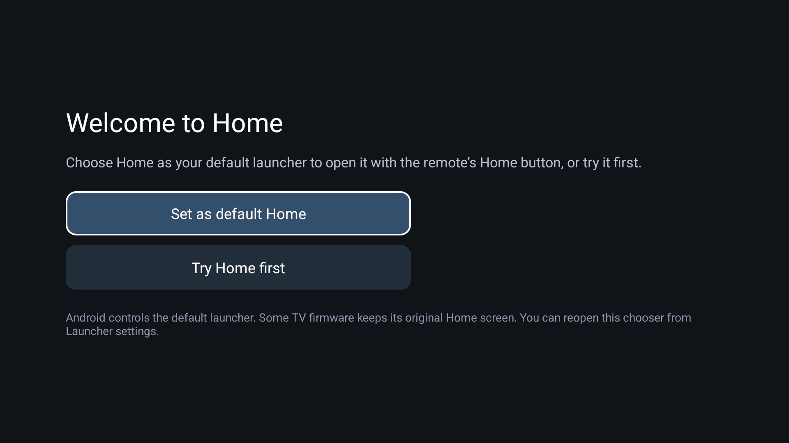

# Home — Android TV dashboard

A personal launcher for Android TV and Google TV, based on [CleanYourTV](https://github.com/Gathin23/cleanyourtv). It provides a scenic home screen, favourites, website shortcuts and a notification drawer. It does not replace the TV firmware.

This repository contains the launcher source and retains the upstream [MIT licence](LICENSE). This is an independent fork, not an official Haier or CleanYourTV release.

## Install and open

1. Download the APK from this repository’s [Releases](https://github.com/006shido/haier-tv-dashboard/releases). Read the notes for that version before installing. The repository is currently private, so downloads require repository access.
2. Copy the APK to the TV using USB or your preferred file-transfer app.
3. Open it with the TV’s file manager and approve installation from that source if Android asks.
4. Open **Home** from the TV’s Apps screen.
5. Select **Set as default Home** to open Android’s launcher chooser, then choose **Home**. Select **Try Home first** if you only want to preview it.

When Home is already the system default, opening its app icon goes straight to the dashboard. You can reopen the system chooser through **Launcher settings → Set as default Home**.

**Some TV firmware overrides the default launcher.** The chooser is provided by Android; this app cannot guarantee that every TV will honour it. On the tested Haier, a separately enabled accessibility helper was needed for reliable Home-button redirection. Basic installation does not enable that helper or grant system permissions. Keep the stock launcher installed and enabled.



### Install from a Windows laptop using ADB

Enable Wireless debugging on the TV and pair Android platform-tools using the TV’s pairing screen. Use the IP and connection port from the main Wireless debugging screen, which can change after a restart.

```powershell
adb connect TV_IP:PORT
adb -s TV_IP:PORT install -r "C:\path\to\home.apk"
```

Replace `TV_IP:PORT` and the file path with your own values. Do not type angle brackets around the address. Turn debugging off when you no longer need it.

Do not use the upstream debloating or build-and-install scripts just to install this launcher. They serve a different purpose and can change which system packages are enabled.

## Using the dashboard

- **Favourites and Apps:** move with the remote’s D-pad and press OK to open an app.
- **Reorder:** hold OK on an app or website, choose **Move**, use the arrow keys, then press OK or Back to finish.
- **Websites:** use **Add website** to save an address. Hold OK to edit it, change its colour, move it or remove it. New installations start with an empty list; updates retain saved links.
- **Vertical navigation:** crossing the Websites row keeps the same visible column. The row scrolls horizontally in complete-card steps.
- **Wallpaper:** choose the scenic background, turn it off, or import an image from TV storage/USB in Launcher settings. A document-picker/file-manager app is needed to select local files.
- **Top toolbar:** Inputs, Wi-Fi, Bluetooth, Notifications and Settings. Hold the gear for additional home actions.
- **Power menu:** hold the gear and select **Restart…** to open the TV power options. With the optional helper enabled, a white rounded outline shows the selected option; use Left/Right and OK, or Back to cancel.
- **Google TV:** use **Switch to Google TV** in launcher settings or the gear’s hold menu. Open the Home app again to return to the custom interface. The tested helper also has **Use this Home screen** to resume redirection.

HDMI, casting, voice search, Ethernet, Bluetooth pairing and installed streaming apps remain managed by the TV. Installation does not disable or remove them.

## Optional access and privacy

The launcher has no Internet permission or telemetry. Website shortcuts open an installed browser, whose network activity and privacy policy are separate.

**Notifications:** enable notification access in Android settings if you want the inbox. It stores up to 60 notifications locally, including their text. Clear that history in the drawer. It receives notifications posted to Android, not every suggestion displayed inside another app.

**Bluetooth:** nearby-device/Bluetooth permission is used to read the paired remote’s reported battery value. That value can disagree with Haier’s low-battery warning; it is not a calibrated measurement.

**Direct accessories shortcut:** the tested Haier native Bluetooth panel requires a separately approved `WRITE_SECURE_SETTINGS` grant. This broad permission is optional and is not needed to try Home or choose it as default. Without it, use TV settings. Installation does not grant it automatically.

**Accessibility helper:** optional, device-specific Home redirection and system power-menu integration. Android grants it the broad ability to read screen contents. After you explicitly open the power menu, the helper attempts to focus its first button for up to two seconds. While that menu remains open, focus/window events trigger reads of SystemUI's `global_actions_view` and the selected button bounds to draw a transparent, rounded white selection outline. The outline follows D-pad selection and is removed when the menu closes. It never clicks Power off/Restart for you, stores no screen contents, and does not read other apps for this feature. It is not required on TVs that honour the native default-Home choice. Revoke it in Android's accessibility settings if you no longer want it.

The Google icon opens account settings. It does not obtain the active Google TV profile photo.

## Build from source

Requirements: JDK 17, Android SDK platform 34 and build-tools 34.

```powershell
cd launcher
.\gradlew.bat --no-daemon testReleaseUnitTest lintRelease assembleRelease
```

On Linux/macOS use `./gradlew` with the same tasks. The APK is generated at `launcher/app/build/outputs/apk/release/app-release.apk`.

Release builds shrink resources and optimise/obfuscate Java code. Keep the matching `app/build/outputs/mapping/release/mapping.txt` locally for crash diagnosis. The scenic background is compressed WebP; imported wallpapers are sampled to a maximum of 1920 × 1080.

The personal APKs currently use the same local Android debug signing key. The private key is not published. Anyone distributing their own build should configure a signing key they control, keep it outside Git and retain it for updates. A build signed with a different key cannot replace an installed copy.

## Versions and rollback

The previous and current APKs in the original snapshot release are different builds. The source archive corresponds to the current source, not the archived pre-cleanup APK. No exact source snapshot of that older custom APK was retained.

Android blocks installing an APK whose version code is lower than the installed version. `adb install -r -d` is not guaranteed to bypass that restriction on a production TV. Do not uninstall or clear Home’s data merely to force a downgrade: that can erase preferences and affect the Home helper. The locally prepared previous-build restore APK changed only its version code and signature using the original matching key.

## Validation and limitations

Test device: Haier Matrix TV DE, Android TV 14. Other firmware can expose different settings screens and restrictions. Custom dashboard/setup menus currently use English text; upstream translations remain for other controls.

Each release states what was actually checked. Build success does not establish compatibility with every TV, and a power-menu focus test is not a test of an actual shutdown or reboot. The custom APK exceeds upstream’s 576 KiB target. The larger upstream Python/tooling suite was not passing in the Windows workspace and is not included in this launcher-only repository. No general latency or frame-rate improvement is claimed.

Generated builds, APKs, local SDK paths, signing keys, TV backups, screenshots, notifications and personal work notes must stay out of source commits. APK downloads belong in Releases. The APKs do not bundle the owner’s website list, account details, app order or imported wallpaper.

See [VALIDATION.md](VALIDATION.md) for this release’s exact checks.
